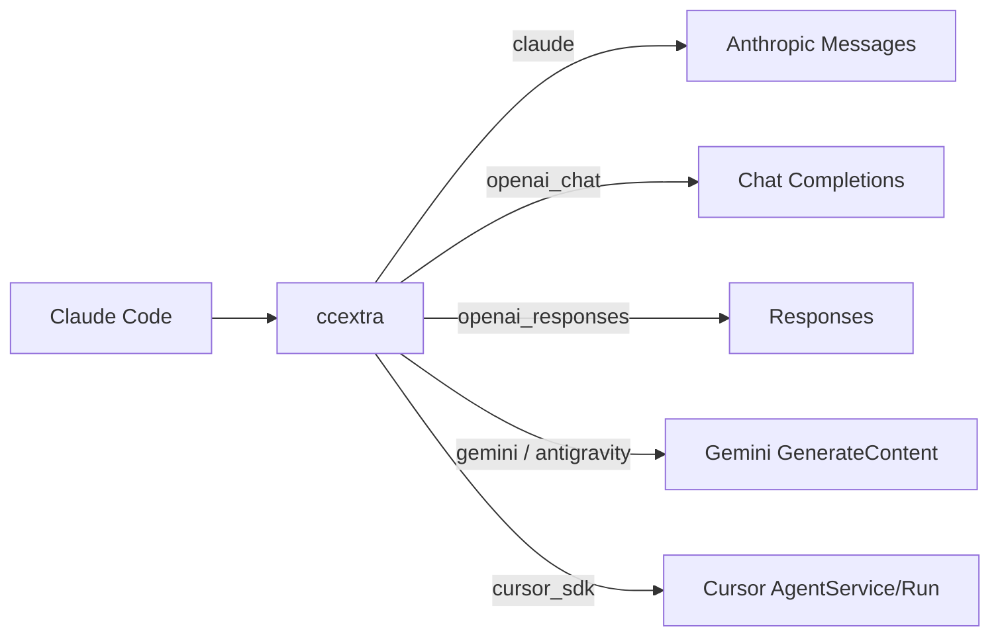

<div align="center">

# ccextra

**Use models from different providers in Claude Code**

Local Anthropic Messages proxy · one port for Claude / OpenAI / Gemini / OAuth

<br>

[](LICENSE)
[](Cargo.toml)
[](Cargo.toml)

[中文](README.md) · **English**

[Features](#features) · [Architecture](#architecture) · [Protocols](#protocol-matrix) · [Quick start](#quick-start) · [Config](#configuration-highlights) · [API](#http-api) · [Design](docs/design.md)

</div>

---

Claude Code sends Anthropic Messages requests; ccextra picks an upstream by model alias, translates the protocol, and returns Anthropic JSON / SSE. One process, one port.

## Features

| | |
| :--- | :--- |
| **Route by model** | Claude, OpenAI, Gemini, Antigravity, and Cursor share one port; `alias` stays separate from upstream `name` |
| **Request stabilization** | Normalize tools, schemas, and history to cut incidental cross-turn drift (hit rate still depends on the upstream) |
| **Capability adaptation** | Message / tool / image conversion; `models.json` clamps reasoning levels |
| **OAuth providers** | Antigravity, xAI Grok, Codex, Claude subscription, Cursor — credential load, refresh, dynamic models |
| **Claude fingerprint lane** | `protocol: claude` defaults to wreq/BoringSSL (Bun-aligned TLS + HTTP/1.1) |
| **Hot reload** | `POST /reload` publishes atomically; in-flight requests keep the old snapshot |

## Architecture



Inbound is always Anthropic-shaped; outbound is restored to Anthropic responses. Details in [architecture](docs/design.md).

## Protocol matrix

| `protocol` | Upstream shape | Adaptation notes |
| :--- | :--- | :--- |
| `claude` | Anthropic Messages | Swap model; sanitize system / effort for non-Claude; response passthrough |
| `openai_chat` | Chat Completions | Messages / tools / images; Kimi thinking params and temperature constraints |
| `openai_responses` | Responses | `instructions` + `input`; reasoning replay, search-domain filtering |
| `gemini` | Gemini GenerateContent | Content blocks, tool results, schema |
| `antigravity` | Cloud Code Assist | Gemini wrapper; tool names and output caps; short connections by default |
| `cursor_sdk` | Cursor AgentService/Run | connect-rpc dual-stream to `api2.cursor.sh`; auto model discovery, session resume |

> **OAuth synthesis**: xAI / Codex → `openai_responses`; Claude subscription → `claude` (same passthrough as static API); Cursor → fixed-name `cursor` `cursor_sdk`. Codex auto-attaches `Chatgpt-Account-Id` and zstd request bodies (CLI-aligned).

## Quick start

### 1. Build

```bash
cargo build --release
```

### 2. Configure

Copy [config.example.yaml](config.example.yaml) to `config.yaml`, or start from a minimal example:

```yaml
server:
  host: "127.0.0.1"
  port: 8222

providers:
  - name: upstream
    protocol: openai_responses
    base_url: https://example.com/v1
    key: sk-xxx
    prompt_cache_key: true
    models:
      - name: your-upstream-model
        alias: coding

normalize:
  enabled: true
  drift_detector: true

logging:
  level: info
  request_body: false

secret_key: "replace-with-your-local-key"
```

`base_url`: include the version prefix for OpenAI protocols (e.g. `/v1`); do not append `/responses` or `/chat/completions`. Claude protocol omits `/v1`.

### 3. Start and connect Claude Code

```bash
./target/release/ccextra --config config.yaml
```

```bash
export ANTHROPIC_BASE_URL=http://127.0.0.1:8222
export ANTHROPIC_AUTH_TOKEN=replace-with-your-local-key   # local secret, not the upstream key
claude --model coding
```

On first load, `secret_key` is bcrypt-hashed and written back; clients keep using the plaintext value.

```bash
curl http://127.0.0.1:8222/health
curl -H "Authorization: Bearer $ANTHROPIC_AUTH_TOKEN" http://127.0.0.1:8222/v1/models
```

Daemon helpers: `build.sh` / `deploy.sh` / `start.sh` / `stop.sh` / `restart.sh` (operate on `./ccextra` in the repo root).

## Configuration highlights

Full fields: [config.example.yaml](config.example.yaml). Common items:

| Item | Notes |
| :--- | :--- |
| `models[].alias` | Inbound model name; must be unique across providers; `base_url` may be a fallback array |
| `server.proxy_url` / provider `proxy_url` | Provider overrides server; `"direct"` = no proxy |
| `secret_key` | Entry auth; bcrypt-written on load; requests use `x-api-key` or `Bearer` |
| `payload` | Glob overrides for top-level params; optional `protocol` scope |
| `prompt_cache_key` | OpenAI paths only; takes Claude Code session ID; does not overwrite a non-empty value |
| `models_file` | Reasoning table (default sibling `models.json`; copy from [models.json.example](models.json.example)) |
| `antigravity_models` / `cursor_models` | Model whitelist (glob / exact); default = all |
| `*_auth_dir` | OAuth credential dirs; default `.cache/<provider>` next to config |

<details>
<summary>Advanced options</summary>

- `user_agents` — override Claude / Codex / Grok / Antigravity identifiers
- `logging.request_body` — write diagnostic requests under `logs/`
- `POST /reload` — atomically publish providers, payload, normalize, auth, proxy, UA, reasoning table, and refresh params; failed loads leave the snapshot unchanged; `logging.level` needs a restart
- Background refresh uses the last successfully published static config; explicit reload prefers removals / disables / directory switches
- `antigravity.connection-pool` — short connections by default; with `enabled: true`, keep the pool per idle / per-host caps
- Cursor: `cursor_base_url`, `cursor_client_version`, `cursor_transport` (`bidi` default / `sse` dual-channel fallback); thinking levels live in `models.json` (by base id); details in [design.md](docs/design.md)

</details>

## HTTP API

| Endpoint | Auth | Role |
| :--- | :---: | :--- |
| `POST /v1/messages` | \* | Anthropic Messages → JSON / SSE |
| `POST /v1/messages/count_tokens` | \* | Claude forwards upstream count; others read session records, miss → 0 |
| `GET /v1/models` | \* | Anthropic-format model list |
| `GET /health` | — | Returns `ok` (does not probe upstream) |
| `POST /reload` | — | Validate and publish new config |

\* When `secret_key` is set, use `x-api-key` or `Authorization: Bearer`.

<details>
<summary>Request pipeline and boundaries</summary>

Pipeline: auth → route → normalize → protocol convert → payload override → upstream.

- **Compatibility**: OpenAI strips `required: null`; Chat maps schema-position `true`→`{}`; Gemini/AG fills `type: object`; blockage codes map to `refusal`; AG neutralizes Claude Code identity sentences and sanitizes non-standard session headers
- **Streaming**: Claude body passthrough; others convert to Anthropic SSE; 10s `: keepalive`
- **Retries**: same-round multi-`base_url` rotation on 429/5xx/network errors; exhaust → fail fast and pass through `Retry-After`; streaming first-frame error retries once internally
- **Read limits**: success body 16 MiB, error 256 KiB, idle 180s; OAuth / project / model reads 30s total timeout
- **Claude headers**: keep permitted identity headers; `anthropic-beta` passthrough by default; append `oauth-2025-04-20` for `sk-ant-oat*` when missing

</details>

## OAuth and operations

```bash
./ccextra antigravity-login && ./ccextra antigravity-status
./ccextra xai-login         && ./ccextra xai-status
./ccextra codex-login       && ./ccextra codex-status
./ccextra claude-login      && ./ccextra claude-status
./ccextra cursor-login      && ./ccextra cursor-status
```

| Provider | Default credential dir | Refresh window | Notes |
| :--- | :--- | :--- | :--- |
| Antigravity | `.cache/antigravity` | 5 minutes early | Model catalog ~3h background refresh |
| xAI Grok | `.cache/xai` | 5 minutes early | Injected on startup scan |
| Codex | `.cache/codex` | 24 hours early | PKCE; callback port default 1455 |
| Claude subscription | `.cache/claude` | 4 hours early | PKCE; callback fixed `localhost:54545`; no cloaking / UA rewrite |
| Cursor | `.cache/cursor` | 10 minutes early | Native connect-rpc; `--no-browser` supported |

Quota / model catalog:

```bash
./scripts/check_antigravity_quota.sh
./scripts/check_grok_quota.sh
./scripts/check_codex_quota.sh
./scripts/check_cursor_quota.sh          # default: quota + catalog; --models = models only
```

Successful login auto `POST /reload` against `--config` `host`/`port` (failure is a warning only). Manual reload:

```bash
curl -X POST http://127.0.0.1:8222/reload
```

<details>
<summary>Claude subscription / Cursor notes</summary>

**Claude subscription** — single-machine, Claude Code CLI clients only:

- `./ccextra claude-login` → injects `protocol: claude` (`base_url=https://api.anthropic.com`)
- Outbound reuses Messages passthrough and cache normalization; refresh retries only on 5xx
- Same shape as static Claude API / proxy — swap `base_url` + key

**Cursor** — no Cursor IDE / `cursor-agent` required:

- Outbound h2 + rustls straight to `api2.cursor.sh`; proxy uses global `proxy` (`"direct"` disables)
- Session state is in-memory and lost on restart; do not commit `cursor.json`
- Parked-session loss falls back to history fabrication; checkpoints use prefix checks; tool-less requests get `<system_constraint>`
- Thinking levels in `models.json` (by base id); run `check_cursor_quota.sh --models` before setting a whitelist

More in [design.md](docs/design.md).

</details>

## Development

```bash
cargo test --workspace
cargo clippy --workspace --all-targets -- -D warnings
```

| Crate | Role |
| :--- | :--- |
| `ccextra-cli` | CLI, startup, config load |
| `ccextra-server` | HTTP, OAuth, SSE, connection pools, fingerprint lane |
| `ccextra-core` | IO-free: routing, normalize, protocol convert, reasoning table |

Terms: [glossary.md](docs/glossary.md).

## License

[MIT](LICENSE)
