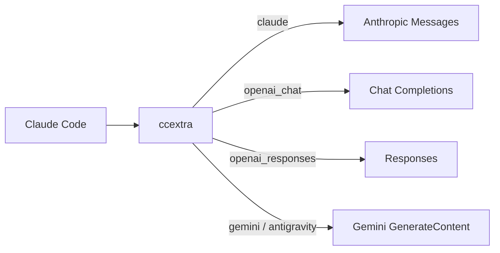

<div align="center">

# ccextra

**Use models from different providers in Claude Code**

Local Anthropic Messages proxy · one port for Claude / OpenAI / Gemini / OAuth

<br>

[](LICENSE)
[](Cargo.toml)
[](Cargo.toml)

[中文](README.md) · **English**

[Features](#features) · [Architecture](#architecture) · [Protocols](#protocol-matrix) · [Quick start](#quick-start) · [Config](#configuration-highlights) · [API](#http-api) · [Design](docs/design.md)

</div>

---

Claude Code sends Anthropic Messages requests; ccextra picks an upstream by model alias, translates the protocol, and returns Anthropic JSON / SSE. One process, one port.

## Features

| | |
| :--- | :--- |
| **Route by model** | Claude, OpenAI, Gemini, and Antigravity share one port; `alias` stays separate from upstream `name` |
| **Request stabilization** | Normalize tools, schemas, and history to cut incidental cross-turn drift (hit rate still depends on the upstream) |
| **Capability adaptation** | Message / tool / image conversion; `models.json` clamps reasoning levels |
| **OAuth providers** | Antigravity, xAI Grok, Codex — credential load, refresh, dynamic models |
| **Claude fingerprint lane** | `protocol: claude` and `anthropic_official` default to wreq/BoringSSL (Bun-aligned TLS + HTTP/1.1) |
| **Hot reload** | Saving `config.yaml` / `models.json` or `POST /reload` publishes atomically; in-flight requests keep the old snapshot |

## Architecture



Inbound is always Anthropic-shaped; outbound is restored to Anthropic responses. Details in [architecture](docs/design.md).

## Protocol matrix

| `protocol` | Upstream shape | Adaptation notes |
| :--- | :--- | :--- |
| `claude` | Anthropic Messages | Swap model; sanitize system / effort for non-Claude; response passthrough |
| `openai_chat` | Chat Completions | Messages / tools / images; Kimi thinking params and temperature constraints |
| `openai_responses` | Responses | `instructions` + `input`; reasoning replay, search-domain filtering |
| `gemini` | Gemini GenerateContent | Content blocks, tool results, schema |
| `antigravity` | Cloud Code Assist | Gemini wrapper; tool names and output caps; short connections by default |
| `anthropic_official` | Anthropic Messages (official subscription) | Verbatim passthrough of client `Authorization` and request bytes; `alias == name`; no conversion, no rebuilt errors, no keepalive; `https://api.anthropic.com` only |

> **OAuth synthesis**: xAI / Codex → `openai_responses`. Codex auto-attaches `Chatgpt-Account-Id` and zstd request bodies (CLI-aligned).

<details>
<summary>Official Anthropic subscription passthrough (<code>anthropic_official</code>)</summary>

Lets Claude Code reach Anthropic through ccextra with its own subscription login. ccextra stores and refreshes no subscription credential; it forwards the client's `Authorization` verbatim to `api.anthropic.com`.

- **Use a standalone instance**: run a separate instance on `127.0.0.1:8223` with no `secret_key` and no `payload`, holding only this provider (template in [scripts/official/config.yaml.example](scripts/official/config.yaml.example)); set `official_instance: on` in the main instance's `config.yaml` and `./service.sh` creates its directory and starts/stops it together. An instance with `secret_key` authenticates first and rejects any key starting with `sk-ant-` with 401.
- **Claude Code side**: set only `ANTHROPIC_BASE_URL=http://127.0.0.1:8223`; do not set `ANTHROPIC_AUTH_TOKEN`, `ANTHROPIC_API_KEY`, or `apiKeyHelper`, otherwise the `Authorization` sent is not the subscription login. A missing `Authorization` (including empty or all-whitespace) gets a local 401; `x-api-key` is not forwarded.
- **Config rules** (checked at startup and `/reload`): `key` must be empty; `base_url` must be a single `https://api.anthropic.com` (port empty or 443, no path / query / fragment / userinfo); no `metadata`; every model has `alias == name`, so `model` is never rewritten.
- **`claude-*` wildcard**: `anthropic_official` only, at most one per provider, must start with `claude-` and have a single trailing `*`. Exact entries win; unlisted `claude-…` snapshot names hit the wildcard and are forwarded verbatim; `claude-`, `claude-*`, `claude-**` return 404; `/v1/models` does not list wildcard entries.
- **Verbatim forwarding**: the request body is forwarded as raw bytes (no normalize, payload override, effort clamp, or system sanitizing); request headers are forwarded as-is (including `Accept-Encoding`) except hop-by-hop, `host`, `content-length`, `x-api-key`, `x-ccextra-key` (`Content-Type` defaults to `application/json` when missing); no beta is appended and no User-Agent is filled in; a missing `Accept-Encoding` is filled by wreq itself, and responses are decoded by ccextra.
- **Outbound TLS**: built the same way as the `protocol: claude` fingerprint lane (wreq/BoringSSL, Bun ClientHello, HTTP/1.1 only) in a separate connection pool, so the TLS layer matches a direct Claude Code connection.
- **Verbatim response**: upstream status, response headers (minus hop-by-hop and `set-cookie`), error bodies, and SSE bytes are returned as-is: no `: keepalive`, no rebuilt errors, no synthetic `timeout_error` / `message_stop`, no 180s idle timeout.
- **No retries**: redirects are not followed; no stale / 400 / 401 retry, no credential refresh, no `base_url` rotation. Local errors: connect failure 502; response-header wait timeout 408 (streaming 60s, non-streaming 600s, count_tokens 60s); when the instance has an official provider, a non-`identity` inbound `Content-Encoding` gets 415 before the body is read.
- `count_tokens` is passed through the same way; `logging.request_body` does not apply to the official path.

</details>

## Quick start

### 1. Build

```bash
cargo build --release
```

### 2. Configure

Copy [config.example.yaml](config.example.yaml) to `config.yaml`, or start from a minimal example:

```yaml
server:
  host: "127.0.0.1"
  port: 8222
  proxy_url: "direct"

providers:
  - name: upstream
    protocol: openai_responses
    base_url: https://example.com/v1
    key: sk-xxx
    prompt_cache_key: true
    models:
      - name: your-upstream-model
        alias: coding

normalize:
  enabled: true
  drift_detector: true

logging:
  level: info
  request_body: false

secret_key: "replace-with-your-local-key"
```

`base_url`: include the version prefix for OpenAI protocols (e.g. `/v1`); do not append `/responses` or `/chat/completions`. Claude protocol omits `/v1`.

### 3. Start and connect Claude Code

```bash
./target/release/ccextra --config config.yaml
```

```bash
export ANTHROPIC_BASE_URL=http://127.0.0.1:8222
export ANTHROPIC_AUTH_TOKEN=replace-with-your-local-key   # local secret, not the upstream key
claude --model coding
```

On first load, `secret_key` is bcrypt-hashed and written back; clients keep using the plaintext value.

```bash
curl http://127.0.0.1:8222/health
curl -H "Authorization: Bearer $ANTHROPIC_AUTH_TOKEN" http://127.0.0.1:8222/v1/models
```

Daemon helpers (macOS): `build.sh` / `deploy.sh` / `start.sh` / `stop.sh` / `restart.sh` manage `./ccextra` via LaunchAgent `com.wanghao.ccextra` (survives quitting the terminal; first run `scripts/macos/install-launchagent.sh`, or `./start.sh` installs the plist). `logs/ccextra.launchd.log` (stdout+stderr) merges/appends into `ccextra.launchd.YYYY-MM-DD.log` only when the Agent is unloaded and about to bootstrap (no timestamped fragments). Hot reload: saving `config.yaml` / startup `models.json` applies (150ms debounce); `POST /reload` still works.

Unified entry `./service.sh start|stop|restart|status|official-init`: always manages 8222 (calls `start.sh` / `stop.sh`); the top-level `official_instance` in `config.yaml` (only that line is read) decides the official passthrough instance: `on` runs `official-init`, then installs and starts LaunchAgent `com.wanghao.ccextra-official` (`../ccextra-official/ccextra --config ../ccextra-official/config.yaml` on 8223, logs in that directory's `logs/` rotated daily on bootstrap, PID in `ccextra.pid`; the plist stays in `~/Library/LaunchAgents`, so it starts at login and KeepAlive restarts it on crash; kickstarts on binary update and re-bootstraps on plist change); `off` boots it out and removes that plist so 8223 is not running. `stop` stops both (keeps the plist when the switch is on). `../ccextra-official` (override with `CCEXTRA_OFFICIAL_DIR`) is a pure runtime directory that can be deleted and rebuilt: `official-init` (ignores the switch, does not start/stop anything) creates the directory and `logs/`, atomically replaces the binary when it differs from the repo-root `./ccextra`, and generates a missing `config.yaml` from [scripts/official/config.yaml.example](scripts/official/config.yaml.example) (0600, `proxy_url` copied from the main `server.proxy_url`, never overwrites). Template, A1 self-check and enablement steps: [scripts/official/](scripts/official/README.md). `deploy.sh` builds, stops 8222 via `stop.sh`, then runs `service.sh start` (when `on`, syncs the binary and kickstarts a running 8223 so it stays on the same version as 8222).

## Configuration highlights

Full fields: [config.example.yaml](config.example.yaml). Common items:

| Item | Notes |
| :--- | :--- |
| `models[].alias` | Inbound model name; must be unique across providers and must not collide with another model's `name`; `base_url` may be a fallback array; `anthropic_official` requires `alias == name` |
| provider `key` | Required and non-blank for non-`anthropic_official` providers; must be empty for `anthropic_official` |
| `server.proxy_url` / provider `proxy_url` | Provider overrides server; one is required, `"direct"`/`"none"` = no proxy, `socks5` is rewritten to `socks5h`; missing / empty / invalid values fail startup and reload |
| `secret_key` | Entry auth; bcrypt-written on load; requests use `x-api-key` or `Bearer`; plaintext must not start with `sk-ant-` |
| `payload` | Glob overrides for top-level params; optional `protocol` scope |
| `prompt_cache_key` | OpenAI paths only; takes Claude Code session ID; does not overwrite a non-empty value |
| `models_file` | Reasoning table (default sibling `models.json`; copy from [models.json.example](models.json.example)) |
| `official_instance` | `on` / `off` (default `off`; `true`/`false` also accepted, anything else fails startup); read only by `service.sh` to decide whether to also manage the 8223 official passthrough instance; no effect on this process, `/reload` does not apply it (logs one INFO hint per change); run `./service.sh start` (keeps 8222 running) or `restart` after changing |
| `antigravity_models` | Model whitelist (glob / exact); default = all |
| `*_auth_dir` | OAuth credential dirs; default `.cache/<provider>` next to config |

<details>
<summary>Advanced options</summary>

- `user_agents` — override Claude / Codex / Grok / Antigravity identifiers
- `logging.request_body` — write diagnostic requests under `logs/` next to the config file (not cwd)
- Access log — one `INFO` `access …` line per `/v1/messages` request (`model` / `provider` / `protocol` / `upstream_model` / `stream` / `status` / `first_byte_ms` / `total_ms`; streaming 2xx logs total duration on stream end or client disconnect), with no headers, body, or keys
- Hot reload — watches `config.yaml` and the startup-pinned `models.json` (save-to-reload, 150ms debounce + content hash); `POST /reload` also works. Atomically publishes providers, payload, normalize, auth, proxy, UA, reasoning table, and refresh params; failed loads leave the snapshot unchanged; `logging.level` needs a restart
- Background refresh uses the last successfully published static config; explicit reload prefers removals / disables / directory switches
- `antigravity.connection-pool` — short connections by default; with `enabled: true`, keep the pool per idle / per-host caps

</details>

## HTTP API

| Endpoint | Auth | Role |
| :--- | :---: | :--- |
| `POST /v1/messages` | \* | Anthropic Messages → JSON / SSE |
| `POST /v1/messages/count_tokens` | \* | Claude forwards upstream count; `anthropic_official` passes through verbatim; others read session records, miss → 0 |
| `GET /v1/models` | \* | Anthropic-format model list |
| `GET /health` | — | Returns `ok` (does not probe upstream) |
| Save config / `POST /reload` | — | Validate and publish new config (file watch and HTTP share one path) |

\* When `secret_key` is set, use `x-api-key` or `Authorization: Bearer`.

<details>
<summary>Request pipeline and boundaries</summary>

Pipeline: auth → route → normalize → protocol convert → payload override → upstream. `anthropic_official` is forwarded verbatim right after routing and skips the rest.

- **Compatibility**: OpenAI strips `required: null`; Chat maps schema-position `true`→`{}`; Gemini/AG fills `type: object`; blockage codes map to `refusal`; AG neutralizes Claude Code identity sentences and sanitizes non-standard session headers
- **Streaming**: Claude body passthrough; others convert to Anthropic SSE; 10s `: keepalive` (`anthropic_official` bytes are verbatim, no keepalive)
- **Retries**: same-round multi-`base_url` rotation on 429/5xx/network errors; exhaust → fail fast and pass through `Retry-After` (filled from the body RetryInfo for Antigravity 429s without the header); streaming first-frame error retries once internally
- **Read limits**: success body 16 MiB, error 256 KiB, idle 180s; OAuth / project / model reads 30s total timeout
- **Claude headers**: keep permitted identity headers; `anthropic-beta` passthrough by default

</details>

## OAuth and operations

```bash
./ccextra antigravity-login && ./ccextra antigravity-status
./ccextra xai-login         && ./ccextra xai-status
./ccextra codex-login       && ./ccextra codex-status
```

| Provider | Default credential dir | Refresh window | Notes |
| :--- | :--- | :--- | :--- |
| Antigravity | `.cache/antigravity` | 5 minutes early | Model catalog ~3h background refresh |
| xAI Grok | `.cache/xai` | 5 minutes early | Injected on startup scan |
| Codex | `.cache/codex` | 24 hours early | PKCE; callback port default 1455 |

Successful login auto `POST /reload` against `--config` `host`/`port` (failure is a warning only). Saving the config file also hot-reloads; manual:

```bash
curl -X POST http://127.0.0.1:8222/reload
```

## Development

```bash
cargo test --workspace
cargo clippy --workspace --all-targets -- -D warnings
```

| Crate | Role |
| :--- | :--- |
| `ccextra-cli` | CLI, startup, config load |
| `ccextra-server` | HTTP, OAuth, SSE, connection pools, fingerprint lane |
| `ccextra-core` | IO-free: routing, normalize, protocol convert, reasoning table |

Terms: [glossary.md](docs/glossary.md).

## License

[MIT](LICENSE)
