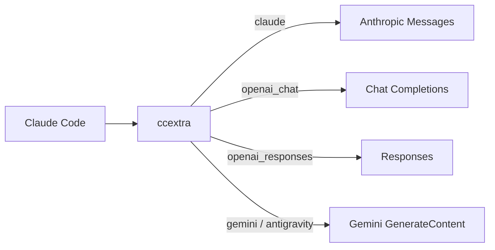

<div align="center">

# ccextra

**在 Claude Code 里用不同上游的模型**

本地 Anthropic Messages 代理 · 一个端口接入 Claude / OpenAI / Gemini / OAuth

<br>

[](LICENSE)
[](Cargo.toml)
[](Cargo.toml)

**中文** · [English](README.en.md)

[特性](#特性) · [架构](#架构) · [协议](#协议矩阵) · [快速开始](#快速开始) · [配置](#配置要点) · [API](#http-api) · [设计](docs/design.md)

</div>

---

Claude Code 发来 Anthropic Messages 请求；ccextra 按模型别名选上游、做协议转换，再以 Anthropic JSON / SSE 返回。单进程、单端口。

## 特性

| | |
| :--- | :--- |
| **按模型路由** | Claude、OpenAI、Gemini、Antigravity 共用一个端口；`alias` 与上游 `name` 分开配 |
| **请求稳定化** | 归一化工具、schema、历史，降低无意义跨轮差异（命中率仍看上游） |
| **能力适配** | 消息 / 工具 / 图片转换；`models.json` 钳制 reasoning 档位 |
| **OAuth 接入** | Antigravity、xAI Grok、Codex — 凭证加载、刷新、动态模型 |
| **Claude 指纹车道** | `protocol: claude` 与 `anthropic_official` 默认走 wreq/BoringSSL（Bun 对齐 TLS + HTTP/1.1） |
| **热重载** | 保存 `config.yaml` / `models.json` 或 `POST /reload` 原子发布；进行中的请求继续用旧快照 |

## 架构



入站始终是 Anthropic 形状；出口统一还原为 Anthropic 响应。细节见 [架构设计](docs/design.md)。

## 协议矩阵

| `protocol` | 上游形态 | 适配要点 |
| :--- | :--- | :--- |
| `claude` | Anthropic Messages | 换模型；非 Claude 再清洗 system / effort；响应直通 |
| `openai_chat` | Chat Completions | 消息 / 工具 / 图片；Kimi 思考参数与温度约束 |
| `openai_responses` | Responses | `instructions` + `input`；reasoning replay、搜索域过滤 |
| `gemini` | Gemini GenerateContent | 内容块、工具结果、schema |
| `antigravity` | Cloud Code Assist | 封装 Gemini；工具名与输出上限；默认短连接 |
| `anthropic_official` | Anthropic Messages（官方订阅） | 原样透传客户端 `Authorization` 与请求字节；`alias == name`；不转换、不重建错误、不插心跳；仅 `https://api.anthropic.com` |

> **OAuth 合成**：xAI / Codex → `openai_responses`。Codex 自动带 `Chatgpt-Account-Id`，请求体 zstd（对齐 CLI）。

<details>
<summary>官方 Anthropic 订阅透传（<code>anthropic_official</code>）</summary>

让 Claude Code 用自己的订阅登录经 ccextra 访问 Anthropic。ccextra 不保存、不刷新任何订阅凭证，只把客户端的 `Authorization` 原样转给 `api.anthropic.com`。

- **建议独立实例**：单独起一个监听 `127.0.0.1:8223` 的实例，不设 `secret_key`、不设 `payload`，只放这一个 provider（模板见 [scripts/official/config.yaml.example](scripts/official/config.yaml.example)）；在主实例 `config.yaml` 设 `official_instance: on` 后由 `./service.sh` 自动建目录并统一启停。设了 `secret_key` 的实例先做入口认证，`sk-ant-` 开头的 key 一律 401。
- **Claude Code 端**：只设 `ANTHROPIC_BASE_URL=http://127.0.0.1:8223`，不要设 `ANTHROPIC_AUTH_TOKEN`、`ANTHROPIC_API_KEY` 或 `apiKeyHelper`；否则发出的就不是订阅登录的 `Authorization`。缺 `Authorization`（含空值、全空白）本地返回 401，`x-api-key` 不转发。
- **配置约束**（启动与 `/reload` 校验）：`key` 必须留空；`base_url` 只能是单个 `https://api.anthropic.com`（端口为空或 443，不含 path / query / fragment / userinfo）；不得设 `metadata`；每个模型 `alias == name`，不改写 `model`。
- **`claude-*` 通配**：仅 `anthropic_official` 可用，每个 provider 至多一条，须以 `claude-` 开头且只有末尾一个 `*`。精确条目优先；未登记的 `claude-…` 快照名命中通配并原样转发；`claude-`、`claude-*`、`claude-**` 返回 404；`/v1/models` 不列出通配条目。
- **原样转发**：请求 body 按原始字节转发（不归一化、不 payload 覆盖、不钳制 effort、不清洗 system）；请求头除 hop-by-hop、`host`、`content-length`、`x-api-key`、`x-ccextra-key` 外原样转发（含 `Accept-Encoding`；缺 `Content-Type` 时补 `application/json`），不追加 beta、不补 User-Agent；缺 `Accept-Encoding` 时由 wreq 自报，响应由 ccextra 透明解压。
- **出站 TLS**：与 `protocol: claude` 同用 Claude 指纹车道构建（wreq/BoringSSL，Bun ClientHello，仅 HTTP/1.1），独立连接池，TLS 层与真实 Claude Code 直连一致。
- **响应原样回传**：上游状态码、响应头（去掉 hop-by-hop 与 `set-cookie`）、错误体与 SSE 字节原样回传：不插 `: keepalive`、不重建错误、不补 `timeout_error` / `message_stop`、不加 180s 空闲超时。
- **不重试**：不跟随重定向，不做 stale / 400 / 401 重试，不刷新凭证，不轮转 `base_url`。本地错误：连接失败 502；等响应头超时 408（流式 60s、非流 600s、count_tokens 60s）；实例含官方 provider 时，入站非 `identity` 的 `Content-Encoding` 在读 body 前返回 415。
- `count_tokens` 同样原样透传；`logging.request_body` 对官方路径不生效。

</details>

## 快速开始

### 1. 编译

```bash
cargo build --release
```

### 2. 配置

复制 [config.example.yaml](config.example.yaml) 为 `config.yaml`，或从最小示例起步：

```yaml
server:
  host: "127.0.0.1"
  port: 8222
  proxy_url: "direct"

providers:
  - name: upstream
    protocol: openai_responses
    base_url: https://example.com/v1
    key: sk-xxx
    prompt_cache_key: true
    models:
      - name: your-upstream-model
        alias: coding

normalize:
  enabled: true
  drift_detector: true

logging:
  level: info
  request_body: false

secret_key: "replace-with-your-local-key"
```

`base_url`：OpenAI 协议含版本前缀（如 `/v1`），不要再拼 `/responses` 或 `/chat/completions`；Claude 协议不含 `/v1`。

### 3. 启动并连接 Claude Code

```bash
./target/release/ccextra --config config.yaml
```

```bash
export ANTHROPIC_BASE_URL=http://127.0.0.1:8222
export ANTHROPIC_AUTH_TOKEN=replace-with-your-local-key   # 本地 secret，不是上游 key
claude --model coding
```

首次加载会把 `secret_key` 写成 bcrypt 并回写配置；客户端仍用原始明文。

```bash
curl http://127.0.0.1:8222/health
curl -H "Authorization: Bearer $ANTHROPIC_AUTH_TOKEN" http://127.0.0.1:8222/v1/models
```

后台（macOS）：`build.sh` / `deploy.sh`（均 `cargo build --release --locked`，按已提交的 `Cargo.lock` 构建，保证指纹车道依赖可复现）/ `start.sh` / `stop.sh` / `restart.sh` 经 LaunchAgent `com.wanghao.ccextra` 管理根目录 `./ccextra`（关终端不杀进程；首次 `scripts/macos/install-launchagent.sh`，或直接 `./start.sh` 会安装 plist）。`logs/ccextra.launchd.log`（stdout/stderr 同文件）仅在 Agent 未加载、即将 bootstrap 时按日合并滚动（append 进 `ccextra.launchd.YYYY-MM-DD.log`，不写时间戳碎片）。热重载：保存 `config.yaml` / 启动时的 `models.json` 即生效（150ms debounce），亦可 `POST /reload`。

统一入口 `./service.sh start|stop|restart|status|official-init`：始终管理 8222（内部调用 `start.sh` / `stop.sh`）；按 `config.yaml` 顶层 `official_instance`（只读这一行）决定官方透传实例：`on` 时先 `official-init`，再安装并拉起 LaunchAgent `com.wanghao.ccextra-official`（`../ccextra-official/ccextra --config ../ccextra-official/config.yaml`，监听 8223，日志在该目录 `logs/` 且 bootstrap 时按日滚动，PID 写 `ccextra.pid`；plist 留在 `~/Library/LaunchAgents`，登录时自启、崩溃由 KeepAlive 重拉；二进制变更时 kickstart，plist 变更时先 bootout 再 bootstrap），`off` 时 bootout 并移除该 plist，确保 8223 未运行。`stop` 两个都停（开关为 on 时保留 plist）。`../ccextra-official`（可用 `CCEXTRA_OFFICIAL_DIR` 覆盖）是纯运行目录，删掉可重建：`official-init`（不看开关、不启停进程）补建目录与 `logs/`，二进制与仓库根 `./ccextra` 不同就原子替换，`config.yaml` 缺失时由 [scripts/official/config.yaml.example](scripts/official/config.yaml.example) 生成（0600，`proxy_url` 取主实例 `server.proxy_url`，已存在不覆盖）。模板、A1 自检与启用步骤见 [scripts/official/](scripts/official/README.md)。`deploy.sh` 构建后先 `stop.sh` 停 8222，再 `service.sh start`（开关 on 时同步二进制并按需 kickstart 8223，保证与 8222 同版本）。

## 配置要点

完整字段见 [config.example.yaml](config.example.yaml)。常用项：

| 项 | 说明 |
| :--- | :--- |
| `models[].alias` | 入站模型名，全局唯一（跨 provider 与同 provider 内均不可重复），可等于其他模型的 `name`；`base_url` 可为回退数组；`anthropic_official` 须 `alias == name` |
| provider `key` | 非 `anthropic_official` 必填且不能为空白；`anthropic_official` 必须留空 |
| `server.proxy_url` / provider `proxy_url` | 后者覆盖前者；必填其一，`"direct"`/`"none"` = 直连，`socks5` 改写为 `socks5h`；缺失/空值/非法值启动或重载报错 |
| `secret_key` | 入口鉴权；加载时 bcrypt 写回；请求用 `x-api-key` 或 `Bearer`；明文不得以 `sk-ant-` 开头 |
| `payload` | 按模型 glob 覆盖顶层参数，可用 `protocol` 限定 |
| `prompt_cache_key` | 仅 OpenAI 路径；取 Claude Code 会话 ID，不覆盖已有非空值 |
| `models_file` | reasoning 表（默认旁路 `models.json`，可从 [models.json.example](models.json.example) 复制） |
| `official_instance` | `on` / `off`（缺省 `off`，也接受 `true`/`false`，其他值启动报错）；仅 `service.sh` 读取，决定是否同时管理 8223 官方透传实例；不影响本进程，`/reload` 不生效（变化时打一次 INFO 提示），改后 `./service.sh start`（不中断 8222）或 `restart` |
| `antigravity_models` | 模型白名单（glob / 精确名）；缺省全量 |
| `*_auth_dir` | OAuth 凭证目录；默认配置旁 `.cache/<provider>` |

<details>
<summary>进阶选项</summary>

- `user_agents` — 覆盖 Claude / Codex / Grok / Antigravity 标识
- `logging.request_body` — 诊断请求写入配置文件目录下的 `logs/`（不跟 cwd）
- 访问日志 — `/v1/messages` 每请求一行 INFO `access …`（model / provider / protocol / upstream_model / stream / status / first_byte_ms / total_ms；流式在流结束或断开时记总耗时），不含 header、body 与 key
- 热重载 — 监视 `config.yaml` 与启动时钉死的 `models.json`（保存即重载，150ms debounce + 内容 hash）；亦可 `POST /reload`。原子发布 providers、payload、归一化、认证、代理、UA、reasoning 表与刷新参数；失败不改快照；`logging.level` 需重启
- 后台刷新用最近成功发布的静态配置；显式 reload 优先应用删除 / 禁用 / 目录切换
- `antigravity.connection-pool` — 默认短连接；`enabled: true` 后按 idle / per-host 上限保留池

</details>

## HTTP API

| 端点 | 鉴权 | 作用 |
| :--- | :---: | :--- |
| `POST /v1/messages` | \* | Anthropic Messages → JSON / SSE |
| `POST /v1/messages/count_tokens` | \* | Claude 转发上游计数；`anthropic_official` 原样透传；其余读会话记录，未命中返回 0 |
| `GET /v1/models` | \* | Anthropic 格式模型列表 |
| `GET /health` | — | 返回 `ok`（不探上游） |
| 保存配置 / `POST /reload` | — | 校验并发布新配置（文件监视与 HTTP 同路径） |

\* 配置了 `secret_key` 时需要 `x-api-key` 或 `Authorization: Bearer`。

<details>
<summary>请求处理与边界</summary>

管线：认证 → 路由 → 归一化 → 协议转换 → payload 覆盖 → 上游。`anthropic_official` 在路由后直接原样转发，跳过后续步骤。

- **兼容**：OpenAI 清 `required: null`；Chat 将 schema 位 `true`→`{}`；Gemini/AG 补 `type: object`；阻断码映射 `refusal`；AG 中和 Claude Code 身份句并清洗非标 session 头
- **流式**：Claude 正文直通，其余转 Anthropic SSE；10s `: keepalive`（`anthropic_official` 字节原样，不插心跳）
- **重试**：同轮多 `base_url` 轮转 429/5xx/网络错误；耗尽快速失败并透传 `Retry-After`（Antigravity 429/503 无头时从 body RetryInfo 补）；流式首帧 error 内部再试一次
- **读取上限**：成功正文 16 MiB、错误 256 KiB、idle 180s；OAuth / project / 模型读取 30s 总超时
- **Claude 头**：保留允许的身份头；`anthropic-beta` 默认透传

</details>

## OAuth 与运维

```bash
./ccextra antigravity-login && ./ccextra antigravity-status
./ccextra xai-login         && ./ccextra xai-status
./ccextra codex-login       && ./ccextra codex-status
```

| Provider | 默认凭证目录 | 刷新窗口 | 备注 |
| :--- | :--- | :--- | :--- |
| Antigravity | `.cache/antigravity` | 提前 5 分钟 | 模型目录约 3h 后台刷新 |
| xAI Grok | `.cache/xai` | 提前 5 分钟 | 启动扫描注入 |
| Codex | `.cache/codex` | 提前 24 小时 | PKCE，回调端口默认 1455 |

登录成功后会按 `--config` 的 `host`/`port` 自动 `POST /reload`（失败只提示）。保存配置文件也会热重载；手动：

```bash
curl -X POST http://127.0.0.1:8222/reload
# 响应示例字段：published / reloaded / failed；仅 published=true 表示快照已切换
```

## 开发

```bash
cargo test --workspace
cargo clippy --workspace --all-targets -- -D warnings
```

| Crate | 职责 |
| :--- | :--- |
| `ccextra-cli` | CLI、启动、配置装载 |
| `ccextra-server` | HTTP、OAuth、SSE、连接池、指纹车道 |
| `ccextra-core` | 无 IO：路由、归一化、协议转换、reasoning 表 |

术语见 [glossary.md](docs/glossary.md)。

## 许可

[MIT](LICENSE)
