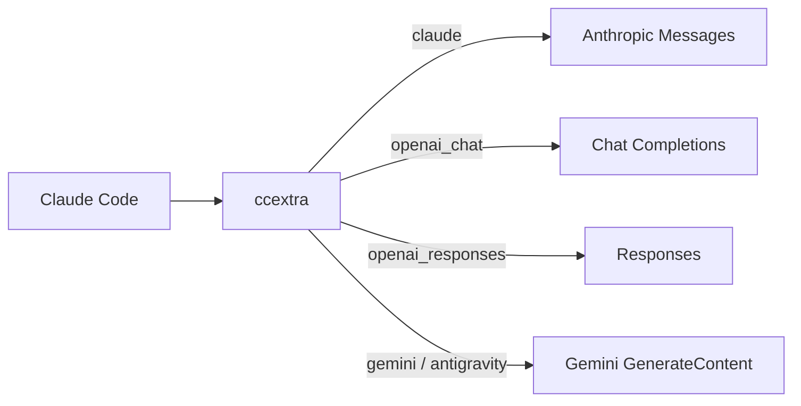

<div align="center">

# ccextra

**在 Claude Code 里用不同上游的模型**

本地 Anthropic Messages 代理 · 一个端口接入 Claude / OpenAI / Gemini / OAuth

<br>

[](LICENSE)
[](Cargo.toml)
[](Cargo.toml)

**中文** · [English](README.en.md)

[特性](#特性) · [架构](#架构) · [协议](#协议矩阵) · [快速开始](#快速开始) · [配置](#配置要点) · [API](#http-api) · [设计](docs/design.md)

</div>

---

Claude Code 发来 Anthropic Messages 请求；ccextra 按模型别名选上游、做协议转换，再以 Anthropic JSON / SSE 返回。单进程、单端口。

## 特性

| | |
| :--- | :--- |
| **按模型路由** | Claude、OpenAI、Gemini、Antigravity 共用一个端口；`alias` 与上游 `name` 分开配 |
| **请求稳定化** | 归一化工具、schema、历史，降低无意义跨轮差异（命中率仍看上游） |
| **能力适配** | 消息 / 工具 / 图片转换；`models.json` 钳制 reasoning 档位 |
| **OAuth 接入** | Antigravity、xAI Grok、Codex、Claude 订阅 — 凭证加载、刷新、动态模型 |
| **Claude 指纹车道** | `protocol: claude` 默认走 wreq/BoringSSL（Bun 对齐 TLS + HTTP/1.1） |
| **热重载** | `POST /reload` 原子发布；进行中的请求继续用旧快照 |

## 架构



入站始终是 Anthropic 形状；出口统一还原为 Anthropic 响应。细节见 [架构设计](docs/design.md)。

## 协议矩阵

| `protocol` | 上游形态 | 适配要点 |
| :--- | :--- | :--- |
| `claude` | Anthropic Messages | 换模型；非 Claude 再清洗 system / effort；响应直通 |
| `openai_chat` | Chat Completions | 消息 / 工具 / 图片；Kimi 思考参数与温度约束 |
| `openai_responses` | Responses | `instructions` + `input`；reasoning replay、搜索域过滤 |
| `gemini` | Gemini GenerateContent | 内容块、工具结果、schema |
| `antigravity` | Cloud Code Assist | 封装 Gemini；工具名与输出上限；默认短连接 |

> **OAuth 合成**：xAI / Codex → `openai_responses`；Claude 订阅 → `claude`（与静态 API 共用直通）。Codex 自动带 `Chatgpt-Account-Id`，请求体 zstd（对齐 CLI）。

## 快速开始

### 1. 编译

```bash
cargo build --release
```

### 2. 配置

复制 [config.example.yaml](config.example.yaml) 为 `config.yaml`，或从最小示例起步：

```yaml
server:
  host: "127.0.0.1"
  port: 8222

providers:
  - name: upstream
    protocol: openai_responses
    base_url: https://example.com/v1
    key: sk-xxx
    prompt_cache_key: true
    models:
      - name: your-upstream-model
        alias: coding

normalize:
  enabled: true
  drift_detector: true

logging:
  level: info
  request_body: false

secret_key: "replace-with-your-local-key"
```

`base_url`：OpenAI 协议含版本前缀（如 `/v1`），不要再拼 `/responses` 或 `/chat/completions`；Claude 协议不含 `/v1`。

### 3. 启动并连接 Claude Code

```bash
./target/release/ccextra --config config.yaml
```

```bash
export ANTHROPIC_BASE_URL=http://127.0.0.1:8222
export ANTHROPIC_AUTH_TOKEN=replace-with-your-local-key   # 本地 secret，不是上游 key
claude --model coding
```

首次加载会把 `secret_key` 写成 bcrypt 并回写配置；客户端仍用原始明文。

```bash
curl http://127.0.0.1:8222/health
curl -H "Authorization: Bearer $ANTHROPIC_AUTH_TOKEN" http://127.0.0.1:8222/v1/models
```

后台：`build.sh` / `deploy.sh` / `start.sh` / `stop.sh` / `restart.sh`（操作根目录 `./ccextra`）。

## 配置要点

完整字段见 [config.example.yaml](config.example.yaml)。常用项：

| 项 | 说明 |
| :--- | :--- |
| `models[].alias` | 入站模型名，不可跨 provider 重复，也不可与其他模型的 `name` 撞车；`base_url` 可为回退数组 |
| `server.proxy_url` / provider `proxy_url` | 后者覆盖前者；`"direct"` = 直连 |
| `secret_key` | 入口鉴权；加载时 bcrypt 写回；请求用 `x-api-key` 或 `Bearer` |
| `payload` | 按模型 glob 覆盖顶层参数，可用 `protocol` 限定 |
| `prompt_cache_key` | 仅 OpenAI 路径；取 Claude Code 会话 ID，不覆盖已有非空值 |
| `models_file` | reasoning 表（默认旁路 `models.json`，可从 [models.json.example](models.json.example) 复制） |
| `antigravity_models` | 模型白名单（glob / 精确名）；缺省全量 |
| `*_auth_dir` | OAuth 凭证目录；默认配置旁 `.cache/<provider>` |

<details>
<summary>进阶选项</summary>

- `user_agents` — 覆盖 Claude / Codex / Grok / Antigravity 标识
- `logging.request_body` — 诊断请求写入配置文件目录下的 `logs/`（不跟 cwd）
- `POST /reload` — 原子发布 providers、payload、归一化、认证、代理、UA、reasoning 表与刷新参数；失败不改快照；`logging.level` 需重启
- 后台刷新用最近成功发布的静态配置；显式 reload 优先应用删除 / 禁用 / 目录切换
- `antigravity.connection-pool` — 默认短连接；`enabled: true` 后按 idle / per-host 上限保留池

</details>

## HTTP API

| 端点 | 鉴权 | 作用 |
| :--- | :---: | :--- |
| `POST /v1/messages` | \* | Anthropic Messages → JSON / SSE |
| `POST /v1/messages/count_tokens` | \* | Claude 转发上游计数；其余读会话记录，未命中返回 0 |
| `GET /v1/models` | \* | Anthropic 格式模型列表 |
| `GET /health` | — | 返回 `ok`（不探上游） |
| `POST /reload` | — | 校验并发布新配置 |

\* 配置了 `secret_key` 时需要 `x-api-key` 或 `Authorization: Bearer`。

<details>
<summary>请求处理与边界</summary>

管线：认证 → 路由 → 归一化 → 协议转换 → payload 覆盖 → 上游。

- **兼容**：OpenAI 清 `required: null`；Chat 将 schema 位 `true`→`{}`；Gemini/AG 补 `type: object`；阻断码映射 `refusal`；AG 中和 Claude Code 身份句并清洗非标 session 头
- **流式**：Claude 正文直通，其余转 Anthropic SSE；10s `: keepalive`
- **重试**：同轮多 `base_url` 轮转 429/5xx/网络错误；耗尽快速失败并透传 `Retry-After`；流式首帧 error 内部再试一次
- **读取上限**：成功正文 16 MiB、错误 256 KiB、idle 180s；OAuth / project / 模型读取 30s 总超时
- **Claude 头**：保留允许的身份头；`anthropic-beta` 默认透传；`sk-ant-oat*` 缺 `oauth-2025-04-20` 时补上

</details>

## OAuth 与运维

```bash
./ccextra antigravity-login && ./ccextra antigravity-status
./ccextra xai-login         && ./ccextra xai-status
./ccextra codex-login       && ./ccextra codex-status
./ccextra claude-login      && ./ccextra claude-status
```

| Provider | 默认凭证目录 | 刷新窗口 | 备注 |
| :--- | :--- | :--- | :--- |
| Antigravity | `.cache/antigravity` | 提前 5 分钟 | 模型目录约 3h 后台刷新 |
| xAI Grok | `.cache/xai` | 提前 5 分钟 | 启动扫描注入 |
| Codex | `.cache/codex` | 提前 24 小时 | PKCE，回调端口默认 1455 |
| Claude 订阅 | `.cache/claude` | 提前 4 小时 | PKCE，回调固定 `localhost:54545`；不 cloaking / 不改 UA |

配额 / 模型目录：

```bash
./scripts/check_antigravity_quota.sh
./scripts/check_grok_quota.sh
./scripts/check_codex_quota.sh
```

登录成功后会按 `--config` 的 `host`/`port` 自动 `POST /reload`（失败只提示）。手动重载：

```bash
curl -X POST http://127.0.0.1:8222/reload
```

<details>
<summary>Claude 订阅要点</summary>

**Claude 订阅** — 单机自用、客户端仅 Claude Code CLI：

- `./ccextra claude-login` → 注入 `protocol: claude`（`base_url=https://api.anthropic.com`）
- 出站复用 Messages 直通与缓存归一化；仅 5xx 可重试 refresh
- 与静态 Claude API / 中转同形，换 `base_url` + key 即可

更多见 [design.md](docs/design.md)。

</details>

## 开发

```bash
cargo test --workspace
cargo clippy --workspace --all-targets -- -D warnings
```

| Crate | 职责 |
| :--- | :--- |
| `ccextra-cli` | CLI、启动、配置装载 |
| `ccextra-server` | HTTP、OAuth、SSE、连接池、指纹车道 |
| `ccextra-core` | 无 IO：路由、归一化、协议转换、reasoning 表 |

术语见 [glossary.md](docs/glossary.md)。

## 许可

[MIT](LICENSE)
